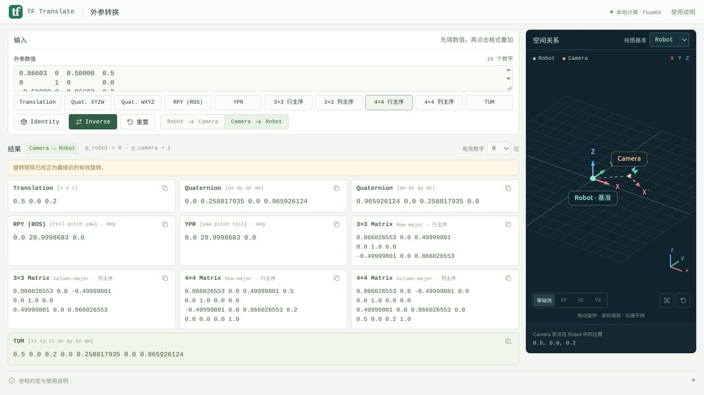

# TF Translate · Robot / Camera 外参转换

在浏览器中逐次叠加外参增量，同时输出十种表示，并交互查看 Robot 与 Camera 的坐标轴。腾讯云 EdgeOne 控制台与 Cloudflare Workers 共用同一套页面、数学核心和视图代码。

## 直接使用

已经生成以下交付文件，部署时不需要 Node.js、npm 或其他外部资源：

| 文件 | 用法 |
| --- | --- |
| [`dist/edgeone.js`](dist/edgeone.js) | 完整复制至腾讯云 EdgeOne 控制台的边缘函数编辑器 |
| [`dist/cloudflare.js`](dist/cloudflare.js) | 完整复制至 Cloudflare Workers 编辑器，使用模块模式 |
| [`dist/index.html`](dist/index.html) | 本地直接打开，或作为普通静态网页托管 |

页面采用紧凑布局：宽屏中输入和十种结果在左侧，空间关系位于最右侧；窄屏按输入、结果、空间关系顺序显示。默认折叠详细说明，在 1280×720 桌面视口下可一页展示主要内容。



所有 CSS、JavaScript、图标都已内联，没有 CDN、字体、数据库、密钥或服务端计算依赖。输入数据仅用于浏览器本地计算，不上传、不持久保存。

## 本地开发

需要 Node.js 20 或更新版本。

```bash
git clone git@github.com:gloryhry/tf_transform.git
cd tf_transform
npm ci
npm run dev
```

打开终端输出的地址，默认是 `http://127.0.0.1:8787`。开发服务器自动重新构建源文件，修改后刷新浏览器即可。其他命令：

```bash
npm run dev -- --port 8788
npm run build
```

`npm run build` 使用 esbuild 打包浏览器脚本，将资源内联并重新生成三个 `dist/` 文件。仓库保留这些可直接部署的文件；修改 `src/` 后请重新构建并一并提交。

源码中 `math.js` 负责解析、校验、叠加和转换，`model.js` 管理草稿和双向结果，`viewer.js` 负责三维图，`app.js` 连接页面操作。构建和本地服务位于 `scripts/`，部署配置位于 `wrangler.jsonc`。本地依赖、验证文件和 ZIP 归档不纳入版本管理。

## 腾讯云 EdgeOne 控制台部署

1. 登录腾讯云 EdgeOne，进入目标站点的 **边缘函数**，新建函数。
2. 将 `dist/edgeone.js` 的完整内容复制到函数编辑器，保存并发布。
3. 为函数配置匹配网页 URL 的触发规则，例如 `https://你的域名/tools/tf*`。函数直接返回网页，无需源站来提供此页面。
4. 访问匹配的 URL，检查页面、转换和三维交互。

使用的是 EdgeOne 控制台边缘函数的 `addEventListener('fetch', …)` / `event.respondWith(...)` 接口。**EdgeOne Pages 的 `onRequest` 是另一种入口，本文件应放入控制台边缘函数。**

官方资料：[返回 HTML 页面](https://edgeone.ai/document/52702)、[Fetch 事件入口](https://edgeone.ai/document/52683)、[边缘函数概述与限制](https://edgeone.ai/document/53372)。当前产物约 48 KiB，构建输出会显示实际大小。

## Cloudflare Workers 部署

### 控制台复制

1. 在 Cloudflare 的 **Workers & Pages** 创建一个 Worker。
2. 在代码编辑器中以 `dist/cloudflare.js` 的完整内容替换示例模块。
3. 保存并部署，使用 Workers 分配的域名或绑定的自定义域名访问。

模块入口是 `export default { fetch: handleRequest }`，不需要环境变量或资源绑定。

### Wrangler CLI

项目根目录提供 `wrangler.jsonc`，入口指向 `dist/cloudflare.js`，部署前自动构建。如需更改 Worker 名称，修改配置中的 `name`。

```bash
npx wrangler login
npx wrangler dev
npx wrangler deploy
```

`wrangler deploy` 会发布到当前登录的 Cloudflare 账户，请在需要部署时自行执行。

官方资料：[Fetch Handler](https://developers.cloudflare.com/workers/runtime-apis/handlers/fetch/)、[返回 HTML](https://developers.cloudflare.com/workers/examples/return-html/)。

两个平台均对触发 URL 的 `GET` 返回 HTML，对 `HEAD` 返回同样的响应头及空正文；其他方法返回 `405` 和 `Allow: GET, HEAD`。默认采用 `Cache-Control: no-cache`，便于更新后重新验证页面。

## 支持的格式

| 格式 | 顺序 | 数字个数 |
| --- | --- | ---: |
| Translation | `x y z` | 3 |
| Quaternion XYZW | `qx qy qz qw` | 4 |
| Quaternion WXYZ | `qw qx qy qz` | 4 |
| RPY (ROS) [deg] | `roll pitch yaw` | 3 |
| YPR [deg] | `yaw pitch roll` | 3 |
| 3×3 Matrix Row-major | 按行展开，每行三个数字 | 9 |
| 3×3 Matrix Column-major | 按列展开，每行三个数字，即一列 | 9 |
| 4×4 Matrix Row-major | 按行展开，每行四个数字 | 16 |
| 4×4 Matrix Column-major | 按列展开，每行四个数字，即一列 | 16 |
| TUM | `tx ty tz qx qy qz qw` | 7 |

本工具的 TUM 格式为七个数字，不包含时间戳。若粘贴常见的八列 TUM 轨迹数据，请先去掉时间戳。

先在输入框填入数值，再点对应的格式按钮。编辑时只更新数字计数；点击才校验并叠加。成功后保留原文，再点一次会再次叠加。个数不符、矩阵无效或计算溢出时，输入区报错，已有结果仍可查看、切换方向和复制。

初始输入与结果均为空。举例：先填 `0.965925826 0.0 0.258819045 0.0` 并点击 **Quat. WXYZ**，再填 `1, 2, 3` 并点击 **Translation**，4×4 矩阵会保留绕 Y 轴 30° 的旋转，并加入平移 `[1, 2, 3]`。十种格式同时更新，矩阵复制遵循卡片标注的展开顺序。

### 混合文本输入

例如填入以下任意内容，再点 Translation 即可应用：

```text
x: 1.25, y: -2.5, z: 3e-2
```

```text
[1.25，−2.5；+.03]
```

支持空格、逗号、中文标点、制表符、换行、括号、等号等。粘贴的 HTML 空白转义（如 `&#x20;`、`&#32;`、`&nbsp;`）也会作为分隔符。提取正负整数、小数、科学计数法，支持全角数字和常见 Unicode 负号。**逗号是数字分隔符，小数使用点。标签或其他文本中的数字仍会计数，例如 `q1`、`3×3` 和时间戳。**

## 外参方向与三维图

统一采用右手系、列向量：

```text
p_target = R · p_source + t
T = [ R  t ]
    [ 0  1 ]
```

默认叠加与输出方向为 **Camera → Robot**：

```text
p_robot = R · p_camera + t
```

两个方向按钮选择同一外参的正向或逆向表示，`Inverse` 切换到另一方向。新数值按当前结果方向解释；切换方向不会应用输入框中的数值。叠加顺序如下：

```text
T_new = ΔT · T_old
R_new = R_delta · R_old
t_new = R_delta · t_old + t_delta
```

没有结果时从单位变换开始。纯平移的增量使用单位旋转，直接增加平移；纯旋转的增量使用零平移，会旋转原有平移。4×4 和 TUM 同时提供增量旋转和平移。**重置**清空结果和空间关系，保留输入、方向、绘图基准与精度；`Identity` 将结果直接设为单位变换。

求逆使用完整的刚体逆变换：

```text
R_inverse = Rᵀ
t_inverse = −Rᵀ · t
```

在「空间关系」的**绘图基准**菜单中选择要固定的坐标系。固定 Robot（默认）时，图中使用 Camera → Robot 变换绘制 Camera；固定 Camera 时，使用 Robot → Camera 变换绘制 Robot。图下方标明另一坐标系的原点在当前基准中的位置。绘图基准可随时选择，与叠加及输出方向独立。

查看 IMU 外参时，用 Robot 表示 `base_link`，用 Camera 表示 IMU。在没有结果时，按默认的 Camera → Robot 方向填入下面的 `imu_to_baselink` 矩阵并点击 4×4 行主序：

```text
 0.86603  0  0.50000  0.5
 0        1  0        0.0
-0.50000  0  0.86603  0.2
 0        0  0        1.0
```

固定 Robot 时，Camera 原点位于 `[0.5, 0, 0.2]`，绕 Y 轴约 +30°。把绘图基准切换为 Camera，Robot 原点约为 `[-0.333014, 0, -0.423204]`，绕 Y 轴约 −30°。

画布采用正交投影、四元数轨迹球，轴长为示意长度，平移比例自动适配。生成单位变换时 Robot 与 Camera 的坐标轴重合，使用不同长度、虚实线和名称区分。应用增量时保留已选的观察角度。初始和重置后均不绘制坐标轴。

| 操作 | 鼠标 / 键盘 | 触摸 |
| --- | --- | --- |
| 旋转 | 左键拖动，或聚焦画布后按方向键 | 单指拖动 |
| 缩放 | 滚轮，或 `+` / `-` | 双指捏合 |
| 平移 | 右键、中键或 Shift + 左键拖动 | 双指拖动 |
| 适应视图 | 点击按钮，或 `F` | 点击按钮 |
| 视角复位 | 点击按钮，或 `R` | 点击按钮 |

## 旋转约定、精度与校验

- RPY 是绕固定 X、Y、Z 轴的 roll、pitch、yaw；使用 `R = Rz(yaw) · Ry(pitch) · Rx(roll)`。YPR 是同一旋转参数的 yaw、pitch、roll 排列。输入输出单位均为度；输出 pitch 在 `[-90°, 90°]`，roll 和 yaw 在 `[-180°, 180°]`。
- 万向节锁检测使用 `hypot(R00, R10) < 1e-10`，此时固定 roll 为零并提示角度解不唯一。验证旋转时应比较旋转矩阵，不应要求原始欧拉角逐项相同。
- 非零四元数自动归一化，支持非常大或非常小的有限分量，零四元数报错。输出采用确定的符号：优先保证 `qw ≥ 0`，当 `qw = 0` 时首个非零分量为正。
- 输入的 3×3 或 4×4 矩阵允许旋转部分有轻微的舍入误差，要求 `max(abs(RᵀR − I)) ≤ 1e-4` 且 `abs(det(R) − 1) ≤ 1e-4`。容差内通过极分解校正为最接近的有效旋转，再用于转换、求逆和三维显示；校正时会给出提示，4×4 的平移分量保持不变。明显的缩放、剪切、反射和退化矩阵仍会报错。
- 4×4 矩阵末行要求 `[0 0 0 1]`，逐元素容差 `1e-8`；容差内规范化并提示。
- 数字个数必须严格匹配，数值必须有限；溢出的科学计数法、叠加或求逆平移会报错。
- 使用 JavaScript `Number`（IEEE 754 float64）完成计算，不按 float32 量化。默认显示 9 位有效数字，可选 1–17 位，结果中的整数带 `.0`，负零输出为 `0.0`。改变显示精度不回写内部状态。
- 低位数显示会舍入复制文本，低精度矩阵再输入时可能无法通过旋转校验；需要保留更多精度时请选择 9–17 位。
- 平移单位跟随输入，不自动换算单位。剪贴板 API 不可用时尝试选择复制；浏览器拒绝复制时仍可手动选中结果。

坐标约定参考：[ROS REP 103](https://github.com/ros-infrastructure/rep/blob/master/rep-0103.rst)。
